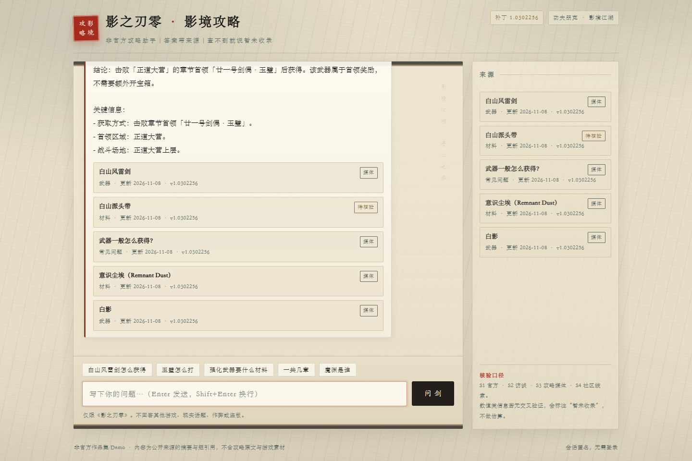

# 影境攻略 · 影之刃零攻略智能客服

《影之刃零》单游戏攻略问答系统。**打开即问、答案带来源、查不到就说「暂未收录」**。

基于对话框架二次开发，替换检索层为 Milvus 向量库，并完成知识库、评测与前端。



> 非官方个人项目。内容为公开来源的摘要与短引用，不含攻略原文与游戏美术素材。

---

## 1. 它解决什么

攻略问答最容易出两类问题：**答得上来但编**，和**编不出来就装懂**。这个项目把两条都卡死：

- **必须带来源**：每条回答附带来源卡片，标注来源等级（S1 官方 / S2 一手 / S3 攻略站 / S4 自媒体）
- **查不到就说查不到**：知识库没有可核验资料时，明确回「暂未收录」，不提供推测值
- **只做一款游戏**：其他游戏、现实话题、作弊破解一律拒答

## 2. 成品指标

| 指标 | 结果 |
|---|---|
| 知识库 | 72 篇攻略 → **81 个 chunk**，32 条来源按 S1–S4 分级 |
| 检索质量（120 题全量） | **Recall@5 98%**、**引用覆盖 98%**、**未知识别 95%** |
| 对抗题 | 抽测 10 道全部安全（含「谎称某武器攻击力是 1337」被纠正为真实区间并给出多源印证） |
| 知识库治理 | 正文「暂未收录」由 260 处降至 **50 处**（-81%），剩余缺口保留「无可靠来源不编造」标注 |
| 检索时延 | 热态均值 299ms，p95 1.15s（本地直连 Zilliz，20 条查询取热态） |
| 首屏 | 115ms，2 个请求，24KB，零图片零外链 |

> 评测口径：完整评测集 120 题（武器 40 / Boss 40 / 剧情 20 / 对抗 20），题目在
> `game_guide_demo/eval/questions.jsonl`，用 `scripts/run_eval.py --full` 复现。Recall@5 与引用覆盖只统计
> 100 道有期望实体的常规题，20 道对抗题只参与未知识别与安全性判定。仓库里 `eval/eval_report.json` 留存的是
> 早期 30 题抽测记录（三项 100%），样本小、不宜作为交付口径，故上表以 120 题全量结果为准。

## 3. 技术栈

- **检索**：Milvus（HNSW + COSINE，1024 维），`game_id` 强制过滤 + 实体提示加权
- **存储**：MySQL（攻略登记 / 匿名会话 / 反馈 / 成本）
- **编排**：LangGraph 状态机（understand → policy → action → guard → response）
- **模型**：DashScope `qwen3.8-flash` + `text-embedding-v4`
- **服务**：FastAPI；前端零依赖单页（原生 JS，无构建）
- **前端风格**：宣纸 + 墨 + 朱砂印章，纯 CSS/SVG 绘制

## 4. 几个值得说的取舍

**把原方案换成了向量检索。** 原方案擅长多跳关系推理，但攻略问题是「单实体精确查询」（某个 Boss 怎么打），额外的遍历延迟和运维成本换不来召回提升。

**分块宁可短，不用套话凑长度。** 武器卡片天然短（200–300 token），硬撑到 300 只能加废话，会让检索命中「套话」而不是答案。

**回答被截断时，降级为原文摘录而不是拒答。** 检索明明命中、模型却因输出预算耗尽返回空串时，直接把知识库原文段落摘出来并标注「未经改写」，比谎称「暂未收录」诚实。

**Flow 卡住要能自救。** 引导式流程一旦卡在等槽位，后续每条消息都会被当成槽位值吞掉；现在检测到「完整新问题」会主动放弃 flow 转检索。

## 5. 快速开始

```powershell
# 📁 在 game_guide_demo 目录执行
cd game_guide_demo
cp .env.example .env          # 填 QWEN_API_KEY、MILVUS_URI/TOKEN、MySQL 连接

..\.venv\Scripts\python.exe scripts\preflight.py    # 环境自检，阻塞项必须为 0
..\.venv\Scripts\python.exe scripts\ingest.py       # 灌知识库
..\.venv\Scripts\python.exe -m uvicorn app:app --host 127.0.0.1 --port 8000
```

浏览器打开 <http://127.0.0.1:8000/>。依赖 Zilliz Cloud（Milvus）与本机 MySQL，详见 [`game_guide_demo/README.md`](game_guide_demo/README.md)。

## 6. 目录结构

```
├── customer_service_system/          # 通用对话框架（对话栈 / 策略组 / 追踪器 / NLU）
│   ├── agent/                        # Agent 装配与 LangGraph 节点
│   ├── policies/                     # FlowPolicy、EnterpriseSearchPolicy
│   ├── retrieval/                    # 检索器接口
│   ├── api/                          # FastAPI 服务与前端模板
│   └── shared/                       # 配置、LLM 客户端、指标
├── game_guide_demo/                  # 领域工程
│   ├── addons/milvus_retrieval.py    # Milvus 检索实现
│   ├── knowledge/phantom_blade_zero/ # 72 篇攻略 + 来源清单
│   ├── scripts/                      # 灌库 / 自检 / 评测
│   ├── eval/questions.jsonl          # 120 题评测集
│   └── docs/                         # 验收手册、门禁记录
├── requirements.txt
└── setup.py
```

## 7. 文档

| 文档 | 内容 |
|---|---|
| [`game_guide_demo/README.md`](game_guide_demo/README.md) | 架构、接口、建库、运行、限制 |
| [`game_guide_demo/docs/验收操作手册.md`](game_guide_demo/docs/验收操作手册.md) | 环境变量清单、每次验收的 8 步、报错对照 |
| [`game_guide_demo/docs/gates/`](game_guide_demo/docs/gates/) | M1–M8 门禁签收记录（含未达标项与证据） |
| [`game_guide_demo/docs/未完成项.md`](game_guide_demo/docs/未完成项.md) | 已知缺口与取舍理由 |

## 8. 已知限制

- 端到端 8–13s（两次 LLM 调用：命令理解 + 回答生成），未达到 <8s 的目标
- 知识库仍有 50 处「暂未收录」，集中在 6 个 Boss 招式与 7 章剧情摘要（无可靠公开来源，不编造）
- 限流与成本计数在进程内，仅适用单实例
- 只在本机运行，未做公网部署

## 9. 免责声明

非官方作品，与游戏开发商 S-GAME 无关。知识库内容为公开攻略站点的摘要与短引用，已标注来源；
如涉及版权问题请联系删除。游戏名称、角色与相关素材版权归原权利人所有。
